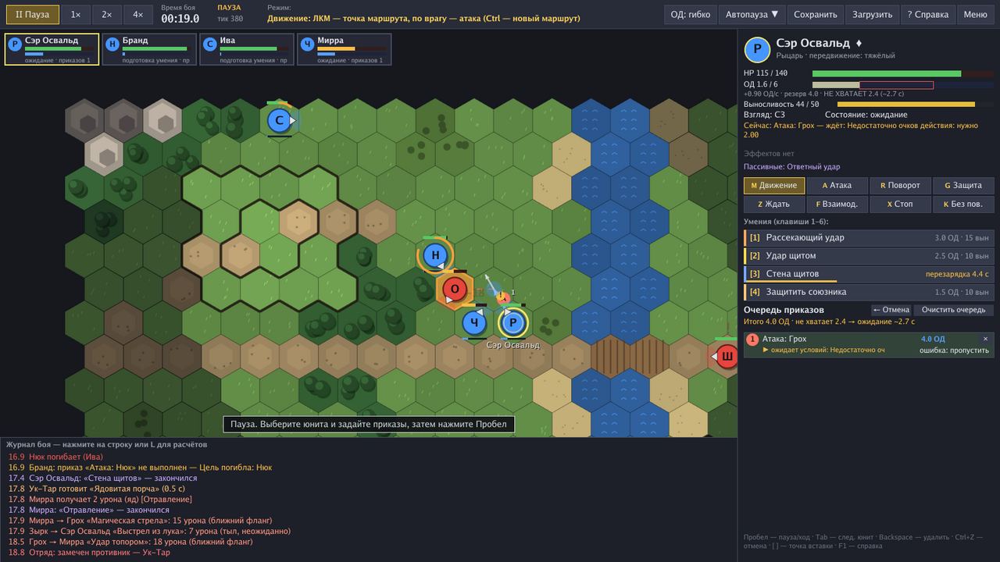

# Hex Tactics — тактический движок в реальном времени с паузой

Настольная игра-прототип и модульный движок по ТЗ: гексагональная карта, игровое время
с паузой и ускорением (0× / 1× / 2× / 4×), очки действия, направленный бой (фронт,
фланги, тыл), очереди приказов с нумерацией и линиями, умения разных типов,
расширяемые характеристики, эффекты, пассивные навыки и ИИ, подчиняющийся тем же
правилам, что и игрок.



## Запуск

Готовые файлы лежат в папке [`release/`](release/):

| Система | Файл | Как запустить |
|---|---|---|
| Windows 10/11 (x64) | `release/HexTactics.exe` | двойной клик |
| Linux (x64) | `release/hextactics-linux` | `chmod +x hextactics-linux` и двойной клик / `./hextactics-linux` |
| macOS | — | собрать из исходников (см. ниже) |

Игра — один самодостаточный файл: шрифты, карты, юниты и умения встроены.
Никакой установки не требуется.

> Windows может показать предупреждение SmartScreen для неподписанной программы:
> «Подробнее» → «Выполнить в любом случае».

Быстрое сохранение (`F5`) пишется в `quicksave.json` рядом с игрой, загрузка — `F9`.
Если игра не смогла запуститься, причина записывается в `hextactics-error.txt` рядом с ней.

## Как играть (кратко)

1. В меню выберите сценарий: **«Полигон»** (чучела, повёрнутые в разные стороны, — удобно
   изучать секторы и умения) или **«Переправа»** (полноценный бой с ИИ).
2. Бой начинается **на паузе**. Выберите юнита (клик или `Tab`) и задайте приказы:
   * клик по клетке — точка маршрута (следующий клик продолжает путь);
   * клик по врагу — «дойти и атаковать»;
   * `1`–`6` — умения (у направленных — наведите мышь на сторону и кликните);
   * `R` — поворот, `G` — защитная стойка с атакой по входящему врагу, `Z` — ожидание,
     `F` — дверь/рычаг, `X` — стоп.
3. `Пробел` — запустить время, `=`/`−` — скорость. Игра сама встанет на паузу при важных
   событиях (настройка — кнопка «Автопауза ▼»).
4. Очередь видна на карте (линии, номера, значки действий) и справа (стоимость, статусы,
   предупреждения, кнопки ↑ ↓ × и политика ошибки у каждого приказа).

Полная справка — `F1` в бою.

| Клавиша / действие | Что делает |
|---|---|
| ЛКМ по своему юниту / карточке, `Tab` | выбор юнита |
| ЛКМ по клетке | точка маршрута; `Ctrl` — новый маршрут; `Shift` — без поворота |
| Перетаскивание своей точки маршрута | изменить промежуточный гекс |
| Клик по точке маршрута / строке очереди | точка вставки: новые действия добавятся в эту точку |
| `[` `]`, `End` | сдвиг точки вставки / в конец очереди |
| `A`, `R`, `G`, `Z`, `F`, `X`, `1`–`6` | атака, поворот, защита, ожидание, взаимодействие, стоп, умения |
| `K` | отключить автоматический поворот при движении |
| `Backspace`, `Delete`, `Ctrl+Z` | удалить приказ, очистить очередь, отменить изменение |
| `PageUp` / `PageDown` | переставить приказ |
| `P` | строгое / гибкое резервирование ОД |
| `Пробел`, `=`, `−` | пауза, скорость |
| Колесо, ПКМ/СКМ-перетаскивание, стрелки, `C` | камера |
| ПКМ, `Esc` | отменить режим ввода / меню |
| `F5` / `F9`, `L`, `F3`, `F1` | сохранить/загрузить, подробный журнал, диагностика, справка |

## Сборка из исходников

Нужен Go 1.26+ (если установлен более старый Go, нужная версия скачается автоматически).

```bash
# Windows-версия (можно собирать на любой ОС)
GOOS=windows GOARCH=amd64 go build -trimpath -ldflags "-s -w -H windowsgui" -o HexTactics.exe ./cmd/hextactics

# Linux (нужны dev-пакеты X11/OpenGL: libgl1-mesa-dev libxrandr-dev libxcursor-dev libxinerama-dev libxi-dev libxxf86vm-dev)
go build -trimpath -ldflags "-s -w" -o hextactics ./cmd/hextactics

# macOS (Apple Silicon; для Intel — GOARCH=amd64)
GOOS=darwin GOARCH=arm64 go build -o hextactics-mac ./cmd/hextactics

# Тесты
go test ./...
```

Скрипт `./build.sh` собирает Windows- и Linux-версии в папку `release/`.

Флаги командной строки: `-scenario training|river_crossing` — сразу открыть сценарий;
`-export-data` — выгрузить встроенные данные в папку `data/` рядом с игрой.

## Модификация данных

Все определения (характеристики, поверхности, эффекты, умения, пассивные навыки,
объекты, классы юнитов, сценарии, правила) хранятся в JSON. Выполните
`HexTactics.exe -export-data` — рядом появится папка `data/`. Если она существует, игра
загружает данные из неё (в меню будет надпись «Данные: папка data»). Ошибки в данных
(неизвестные ссылки, опечатки в полях) показываются при запуске со списком причин.
Форматы описаны в [docs/DATA_FORMATS.md](docs/DATA_FORMATS.md).

## Документация

* [docs/ARCHITECTURE.md](docs/ARCHITECTURE.md) — стек, модули, зависимости, порядок обновления, расчёты;
* [docs/DECISIONS.md](docs/DECISIONS.md) — решения по вопросам из раздела «Что нужно уточнить» и трактовки ТЗ;
* [docs/DATA_FORMATS.md](docs/DATA_FORMATS.md) — форматы данных и как добавить характеристику/умение без изменения ядра;
* [docs/TESTING.md](docs/TESTING.md) — тесты, соответствие критериям приёмки и сценариям A–F, результаты;
* [docs/ROADMAP.md](docs/ROADMAP.md) — ограничения, нереализованное и план следующих этапов.

## Структура

```
cmd/hextactics/    точка входа (окно, флаги, загрузка данных)
engine/hex/        геометрия гексов: координаты, соседи, расстояния, направления, области, линии
engine/gamemap/    карта: клетки, местность, высоты, двери, стоимость шага, Dijkstra/A*, линия видимости
engine/stats/      универсальные характеристики и модификаторы с явным порядком расчёта
engine/combat/     секторы и разрешение атаки (неожиданность, попадание, уклонение, блок, крит, урон)
engine/data/       определения из JSON + встроенный набор данных (content/)
engine/rng/        детерминированный ГСЧ с сериализуемым состоянием
engine/sim/        мир, часы, команды, приказы и исполнение, умения, эффекты, пассивки, ИИ, сохранение
ui/                интерфейс на Ebitengine (только читает мир и отправляет команды)
docs/              документация
release/           готовые исполняемые файлы
```
